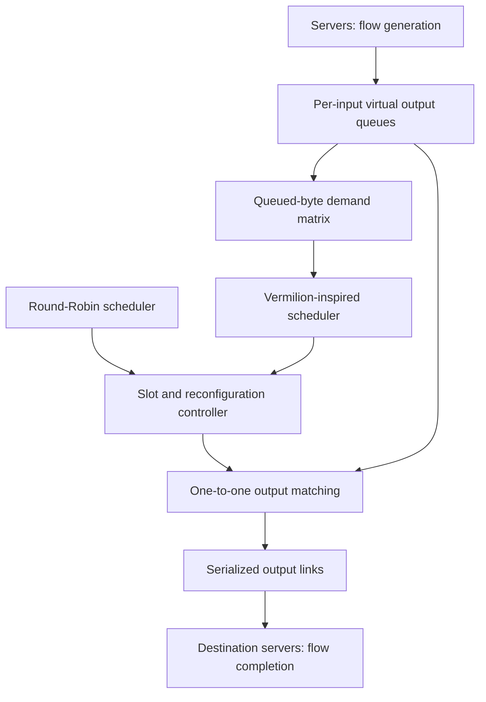

# Optical Data Center Simulation

**Explore how optical circuit scheduling affects flow completion, buffering, and packet loss.**

A C++ / OMNeT++ discrete-event simulation of servers connected through a central optical switch. Compare a cyclic **Round-Robin** baseline with a **Vermilion-inspired, demand-aware scheduler** under uniform, permutation, hotspot, and synthetic web-search traffic.

The model makes the tradeoff explicit: a matching connects each input to at most one output, while changing that matching costs reconfiguration time.

## What is implemented

- **Demand-driven scheduling:** build a schedule from bytes currently queued at the switch, without inspecting the configured traffic pattern.
- **Conflict-free matchings:** normalize demand, construct a regular bipartite multigraph, and decompose it using augmenting paths.
- **Virtual output queues:** separate destinations at each input, with a configurable shared packet capacity.
- **Serialized transmission:** respect link busy times, resume service on transmission completion, and finish packets before a slot boundary.
- **End-to-end flow accounting:** identify flows by `(source, flowId)` and measure completion from source creation to final-byte arrival.
- **Repeatable experiments:** independent source RNG streams, paired seeds across algorithms, and optional traffic-stop/drain phases.

> This is an educational, packet-level model with buffered switch inputs. The scheduler is inspired by Vermilion; it is not a validated reproduction of the published algorithm or its performance guarantees.

## Architecture



`Server` generates Poisson flow arrivals, packetizes them lazily, and shares its link among active flows in packet round-robin order. `OpticalSwitch` owns buffering, scheduling, reconfiguration, and forwarding. `VermilionScheduler` is independent of OMNeT++ and can be tested with a standard C++ compiler.

## Quick start

Use **OMNeT++ 6.1**, a C++17 compiler, GNU Make, and Python 3 for the smoke tests. INET is not required. See the [official OMNeT++ installation guide](https://doc.omnetpp.org/omnetpp/InstallGuide.pdf) for platform setup. Earlier OMNeT++ releases have not been verified.

In an OMNeT++ terminal (or after sourcing its `setenv`):

```bash
git clone https://github.com/Dolevish/Omnet-Project-Optical-Data-Center-Simulation.git
cd Omnet-Project-Optical-Data-Center-Simulation
make makefiles
make -j2 MODE=release
./simulations/run -u Cmdenv -c Vermilion_Uniform -r 0
```

The launcher works from any working directory and handles Windows `.exe` names. On Windows, use the shell supplied with OMNeT++. For a graphical run, replace `Cmdenv` with `Qtenv` in an installation that includes GUI support.

**IDE:** import the repository with **File → Import → Existing Projects into Workspace**, build the `release` configuration, then launch `simulations/omnetpp.ini` and select a configuration. Portable Eclipse/OMNeT++ project metadata is retained; generated binaries and local UI state are excluded.

## Experiments

| Traffic | Demand-aware | Round-Robin | Destination selection |
|---|---|---|---|
| Uniform | `Vermilion_Uniform` | `RoundRobin_Uniform` | Equal probability across other servers |
| Permutation | `Vermilion_Permutation` | `RoundRobin_Permutation` | Server `i` → `(i + 1) mod N` |
| Skewed | `Vermilion_Skewed` | `RoundRobin_Skewed` | Hot/cold destination groups, excluding the source |
| Web search | `Vermilion_WebSearch` | `RoundRobin_WebSearch` | Skewed destinations with a synthetic flow-size mixture |

The default experiment is **8 servers**, **100 Gbps links**, **1 Gbps mean offered load per server**, **10 μs slots**, **0.5 μs reconfiguration**, and **1,500-byte packets**. Runs last 100 ms with a 10 ms statistics warm-up. Each configuration has three repetitions, using seeds 0, 1, and 2. `-r 0` selects the first; omit it to run all repetitions.

```bash
# Run the paired permutation experiments with the same seed.
./simulations/run -u Cmdenv -c Vermilion_Permutation -r 0
./simulations/run -u Cmdenv -c RoundRobin_Permutation -r 0

# Change offered load; quote wildcard-containing overrides.
./simulations/run -u Cmdenv -c Vermilion_Skewed -r 0 \
  '--*.server[*].sendRate=10Gbps' --sim-time-limit=1s

# Stop arrivals, then allow queues and flows to drain.
./simulations/run -u Cmdenv -c Vermilion_Uniform -r 0 \
  '--*.server[*].trafficStopTime=80ms' --warmup-period=0s

# Enable time-series recording when needed.
./simulations/run -u Cmdenv -c Vermilion_Uniform -r 0 \
  '--**.vector-recording=true'
```

Results are written under `simulations/results/`. Repeating a configuration/run number in the same directory replaces its output; use `--result-dir=results/my-experiment` for separate experiments.

### Parameters worth changing

| Parameter | Meaning |
|---|---|
| `*.numServers` | Number of servers and switch ports; minimum 2 |
| `*.linkRate` | Physical serialization rate in both directions |
| `*.propagationDelay` | One-way delay on each server–switch link |
| `*.packetBytes` | Maximum packet payload; must fit in the active slot |
| `*.server[*].sendRate` | Expected offered bits/second; zero disables arrivals |
| `*.server[*].trafficStopTime` | Arrival cutoff; `-1s` means no cutoff |
| `*.server[*].maxPendingFlows` | Source admission limit; excess flows are rejected |
| `*.server[*].skewFactor` | Probability of selecting the hot destination group |
| `*.opticalSwitch.queueCapacity` | Packet capacity per input, shared across its destination queues |
| `*.opticalSwitch.timeslotDuration` | Total slot duration, including any reconfiguration downtime |
| `*.opticalSwitch.reconfigurationDelay` | Downtime when the matching changes; must be smaller than a slot |
| `*.opticalSwitch.k` | Demand-weighting parameter; positive integer |

The INI allocates 64 RNG streams. Increase `num-rngs` if using more than 64 servers. Higher `k` increases demand weighting and schedule length, but also delays adaptation to changing queues. Unchanged consecutive matchings incur no reconfiguration delay; the initial matching is installed at time zero.

## Reading the results

Open `.sca` / `.vec` files in the OMNeT++ Analysis tool. Vector recording is disabled by default to keep runs lightweight.

| Metric | Interpretation |
|---|---|
| `flowCompletionTime` | Source flow creation → final packet arrival; completed flows only |
| `packetDelay` | Packet creation at source serialization → destination arrival |
| `bufferSize` | Total queued switch packets; time average and maximum |
| `packetsDropped` | Packets rejected because an input's capacity is full |
| `flowsRejected` | Flows rejected by source admission control |
| `goodputBps` | Received payload bits / elapsed simulation time, per server |
| `outputUtilization` | Busy output-transmission time / total output-port time |
| `flowsIncompleteAtReceiver` | Partially received flows still incomplete at termination |
| `packetsQueued`, `flowsPendingAtSource` | Work remaining at termination |

**Warm-up semantics:** signal-based statistics obey `warmup-period`; explicit counters and `goodputBps` / `outputUtilization` are whole-run diagnostics. FCT samples are filtered by completion time, so a flow created before warm-up may still contribute afterward. Compare matching measurement windows.

A low mean FCT alone does not imply a better scheduler: dropped or unfinished flows do not produce FCT samples. Inspect completed/generated flows, losses, and residual queues together. Use several repetitions and longer runs before drawing performance conclusions; no comparative benchmark claim is made here.

## Validation

```bash
# No OMNeT++ installation needed: C++ scheduling invariants.
make test

# After building the simulator: real end-to-end scenarios.
make smoke
```

The scheduler tests cover 960 seeded demand matrices across 2–32 ports and multiple `k` values, checking unique outputs, demand coverage, deterministic results, ring traffic, empty demand, and invalid inputs. Smoke tests cover all eight configurations, lossless draining, flow identity across sources, zero load, two-server hotspot/web-search traffic, buffer drops, source admission, propagation delay, and invalid parameters.

See [model details](docs/model.md) for assumptions and scheduler mechanics, and [maintenance notes](docs/maintenance.md) for the cleanup and correctness changes.

## Repository map

| Path | Purpose |
|---|---|
| `src/Server.*` | Workload generation, source service, and destination flow accounting |
| `src/FlowPacket.h` | Typed packet metadata with precise flow timestamps |
| `src/OpticalSwitch.*` | Virtual output queues and slot-aware forwarding |
| `src/VermilionScheduler.*` | Standalone matching algorithm |
| `src/*.ned`, `src/package.ned` | Network and module definitions |
| `simulations/omnetpp.ini` | Paired experiment configurations |
| `simulations/run` | Portable launcher |
| `tests/` | Scheduler and full-simulation checks |
| `.github/workflows/ci.yml` | Automated build and validation |
| `docs/` | Model assumptions and maintenance record |

## Scope

The simulation abstracts optical hardware into a reconfiguration delay and a conflict-free matching. It does not model TCP, retransmission, acknowledgements, optical impairments, control-plane latency, or distributed simulation. The web-search workload is a synthetic three-component mixture, not a replay of a measured trace. Incomplete receive-flow metadata is retained until the run ends; long overloaded runs should be monitored for memory growth.

**Author:** Dolev Ishay
